<h1 align="center">
  
</h1>

<h3 align="center">
  Detecting Sales Anomalies • Monitoring Business Risk • Generating Insights
</h3>

  
  
  
  
  

---

# SignalSentinel AI

## Intelligent Business Early-Warning System
**SignalSentinel AI** is an intelligent business early-warning system designed to identify unusual retail sales behaviour, detect potential store-level sales declines, and highlight business patterns that may require further investigation.

The project combines **SQL, Python, Statistical Analysis, Machine Learning, and Power BI** to transform historical retail sales data into actionable business insights.

###  Project Objectives

- Monitor historical retail sales performance.
- Identify unusual sales patterns using statistical analysis.
- Detect potential store-level sales declines.
- Compare rule-based alerts with machine learning detections.
- Investigate weekday, monthly, and calendar-related sales patterns.
- Visualize findings through an interactive Power BI dashboard.

---

##  Project Workflow

```mermaid
flowchart LR
    A["Retail Sales Data"] --> B["PostgreSQL"]
    B --> C["Python Analytics"]
    C --> D["Statistical Analysis"]
    D --> E["Isolation Forest"]
    E --> F["Power BI Dashboard"]
    F --> G["Business Insights"]

    style A fill:#E8EAF6,stroke:#0C0F5E,color:#0C0F5E
    style B fill:#E8EAF6,stroke:#0C0F5E,color:#0C0F5E
    style C fill:#E8EAF6,stroke:#0C0F5E,color:#0C0F5E
    style D fill:#E8EAF6,stroke:#0C0F5E,color:#0C0F5E
    style E fill:#DCD6F7,stroke:#0C0F5E,color:#0C0F5E
    style F fill:#FFF2CC,stroke:#C9A227,color:#333333
    style G fill:#D9EAD3,stroke:#38761D,color:#274E13
```

---

##  Technology Stack

| Category | Technologies |
|---|---|
| Programming | Python |
| Data Analysis | Pandas, NumPy |
| Database | PostgreSQL, SQL |
| Machine Learning | Scikit-learn, Isolation Forest |
| Statistical Analysis | Historical Baselines, Z-Score |
| Visualization | Power BI, Matplotlib |
| Development Tools | VS Code, Jupyter Notebook, Git, GitHub |

---

##  Dataset

The project uses the **M5 Forecasting Accuracy dataset**, based on Walmart retail sales.

### Dataset Components

| File | Description |
|---|---|
| `sales_train_validation.csv` | Historical daily product sales |
| `calendar.csv` | Dates, weekdays, events, and calendar information |
| `sell_prices.csv` | Product selling prices across stores |

### Dataset Overview

| Attribute | Details |
|---|---:|
| Product-store sales series | 30,490 |
| Retail stores | 10 |
| Products | 3,049 |
| Historical daily observations per series | 1,913 |
| Historical period | January 2011 – April 2016 |

The dataset provides the foundation for sales analysis, anomaly detection, and store-level performance monitoring.

---

##  Exploratory Data Analysis

### 1. Daily Sales Analysis

Analyzed daily sales performance across the historical dataset.

| Metric | Result |
|---|---:|
| Reported average daily sales | 34,342 units |
| Reported highest daily sales | 57,218 units |
| Reported lowest daily sales | 11 units |

These are the values previously reported for the project. The calculation script and aggregation level are not available at the documented path, so the README cannot confirm whether these are totals across all stores or another aggregation. Do not compare them with per-store figures without that definition.

### 2. Weekly Sales Patterns

Identified differences in sales behaviour across weekdays.

| Weekday | Reported average daily sales (units; aggregation not verified) |
|---|---:|
| Saturday | 41,547 |
| Sunday | 41,130 |
| Wednesday | 30,010 |

**Key Insight:** Saturday average sales were approximately 38.4% higher than Wednesday average sales.

### 3. Monthly Sales Patterns

Analyzed monthly average daily sales to identify seasonal variations.

- August recorded the highest average daily sales.
- May recorded the lowest average daily sales.
- The difference between these monthly averages was approximately 10.6%.

### 4. Calendar and Year-End Investigation

Investigated unusual sales patterns around holidays and calendar events.

- December 25 recorded exceptionally low sales across the observed years.
- December 2014 showed multiple simultaneous store-level decline alerts.
- Calendar patterns were investigated without assuming that recorded events directly caused the observed changes.

---

##  Rule-Based Store Decline Detection

Developed a rule-based monitoring approach to identify potential store-level sales declines.

### Detection Logic

The system compares:

- Recent 7-day average sales.
- Previous 28-day average sales.

A potential decline alert is generated when the recent average is at least **15% below** the previous 28-day average.

### Results

| Metric | Result |
|---|---:|
| Stores monitored | 10 |
| Store-day records analyzed | 18,790 |
| Potential decline alerts | 720 |
| Alert rate | 3.83% of analyzed store-day records (720 / 18,790) |

**Note:** The 15% threshold is exploratory and has not been independently validated.

---

##  Statistical Anomaly Detection

Developed weekday-adjusted statistical anomaly detection using historical sales patterns.

### Methodology

1. Calculated historical averages for the same weekday.
2. Compared actual sales against the weekday baseline.
3. Used historical standard deviation to calculate anomaly scores.
4. Applied an absolute Z-score threshold greater than 3.

### Results

| Metric | Result |
|---|---:|
| Days evaluated | 1,857 |
| Total anomalies | 52 |
| Unusually high days | 26 |
| Unusually low days | 26 |

This approach helps distinguish unusual sales activity from normal weekday variations.

---

##  Machine Learning — Isolation Forest

Implemented an unsupervised machine learning approach using the **Isolation Forest** algorithm.

The model identifies unusual sales behaviour across the 10 retail stores.

### Feature Engineering

Three historical features were developed:

| Feature | Description |
|---|---|
| Daily Sales Deviation | Difference between actual sales and previous 7-day average |
| Weekday Deviation | Difference between actual sales and historical average for the same weekday |
| Sales Trend | Comparison between previous 7-day and 28-day average sales |

All rolling averages use historical observations rather than the current day's sales.

### Model Configuration

| Parameter | Configuration |
|---|---|
| Algorithm | Isolation Forest |
| Estimators | 200 |
| Random State | 42 |
| Contamination | Auto |
| Training Strategy | Chronological 80/20 split |

### Training and Testing

| Parameter | Result |
|---|---|
| Training records | 14,800 |
| Testing records | 3,710 |
| Training period | April 2011 – April 2015 |
| Testing period | April 2015 – April 2016 |

The chronological split evaluates the model on later historical observations rather than randomly mixed records.

---

##  Model Evaluation and Comparison

Two Isolation Forest approaches were compared using the same 3,710 test records.

### Model Comparison

| Metric | Original Model | Weekday-Adjusted Model |
|---|---:|---:|
| Anomalies detected | 473 | 374 |
| Both models flagged | 284 | 284 |
| Original-only detections | 189 | — |
| Adjusted-only detections | — | 90 |
| Rule-based alerts | 98 | 98 |
| Rule alerts also flagged by model (share of 98 rule alerts) | 93.88% (92 / 98) | 74.49% (73 / 98) |

### Weekday-Adjusted Model Results

| Metric | Result |
|---|---:|
| Test records | 3,710 |
| ML anomalies detected | 374 |
| ML anomaly rate | 10.08% |
| Rule-based alerts | 98 |
| Both methods flagged | 73 |
| ML-only detections | 301 |
| Rule-only detections | 25 |
| Rule alerts also flagged by adjusted model (73 / 98 rule alerts) | 74.49% |

### Weekend Anomaly Comparison

The README previously listed weekend anomaly percentages, but the denominator and calculation are not documented and the analysis script is unavailable at its documented path. Those percentages are omitted here until the calculation can be verified.

The weekday-adjusted model was selected as the primary experimental model because of its changed anomaly distribution after weekday-aware feature engineering.

> **Evaluation limitation:** Rule-based alerts are comparison references, not verified ground-truth labels. This overlap measure must not be interpreted as model accuracy. The scripts and report artifacts needed to reproduce these figures were not available at their documented paths during this review.

---

##  Power BI Dashboard

Developed an interactive Power BI dashboard to monitor historical sales performance and investigate detected anomalies.

### Dashboard Preview

No dashboard screenshot was available at the documented path during this review. Add a committed `assets/dashboard.png` before presenting the dashboard as a verified repository artifact.

### Dashboard Features

| Section | Visualizations |
|---|---|
| Business KPIs | Total Units Sold, Average Daily Sales, Anomaly Days |
| Sales Analysis | Daily Sales Trend, Monthly Sales Pattern |
| Anomaly Analysis | High vs Low Anomalies |
| Store Monitoring | Store-wise Decline Alerts, Widespread Alert Analysis |
| Machine Learning | ML Anomaly Count, ML Anomaly Rate |
| ML Distribution | Weekday-Adjusted Trend, Store-wise ML Anomalies |
| Interactive Filters | Year, Month, Date Range |

### Dashboard Interaction Preview

You can also add a short GIF showing the dashboard responding to slicer selections.

Save it as `assets/dashboard-demo.gif`.

  

---

##  Business Value

SignalSentinel AI demonstrates how historical retail data can be converted into a structured monitoring and investigation workflow.

Potential business applications include:

- Identifying unusual sales activity.
- Prioritizing stores for further investigation.
- Monitoring store-level performance changes.
- Understanding weekday and monthly sales patterns.
- Comparing statistical and machine learning detection approaches.
- Supporting data-driven business decisions through interactive reporting.

The system highlights potential issues; business teams must investigate the underlying causes.

---

##  Limitations and Future Improvements

### Current Limitations

- No independently verified anomaly labels are available.
- Model accuracy cannot currently be established.
- Rule-based thresholds require further validation.
- Historical anomaly detection does not establish causation.
- The current system does not produce validated future-sales forecasts or prospective decline-risk predictions.

### Future Improvements

- Develop a validated future sales forecasting model.
- Introduce predictive store-level decline-risk scoring.
- Improve anomaly detection with additional seasonal features.
- Evaluate alternative anomaly detection algorithms.
- Establish a feedback mechanism for verified business anomalies.
- Develop automated monitoring and alert reporting.
- Explore deployment as a production monitoring application.

---

##  Project Structure

The README previously listed scripts, datasets, reports, a trained model, and a Power BI file. Those paths were not verifiable on the default branch during this review. To keep the project map accurate, add a directory tree here after the artifacts are committed.

---

##  Project Status

| Component | Status on the default branch |
|---|---|
| Analysis scripts and SQL | Not available at the paths previously listed |
| Input dataset | Referenced, but not included at the documented paths |
| Report and evaluation outputs | Not available at the paths previously listed |
| Trained model | Referenced, but not available at the documented path |
| Power BI dashboard and preview image | Referenced, but not available at the documented paths |
| Production deployment | Not documented |

The earlier README marked several components as completed. Those claims could not be verified from the files available at their documented paths. Update this table when the implementation artifacts are committed.

---

##  Key Takeaway

SignalSentinel AI combines SQL, Python, statistical analysis, unsupervised machine learning, and Power BI to demonstrate an end-to-end retail analytics and historical anomaly monitoring workflow.

It provides a practical example of how data analytics and machine learning can support business performance monitoring and investigation.

---

## 👨‍💻 Author

  <b>Anjeet Yadav</b> 
  Data Analytics | SQL | Python | Machine Learning | Power BI

  
  
  
  

  <i>Built as a data analytics and machine learning portfolio project.</i>

---

  Historical anomaly detections are experimental and should not be treated as verified business incidents or production-ready predictions.

